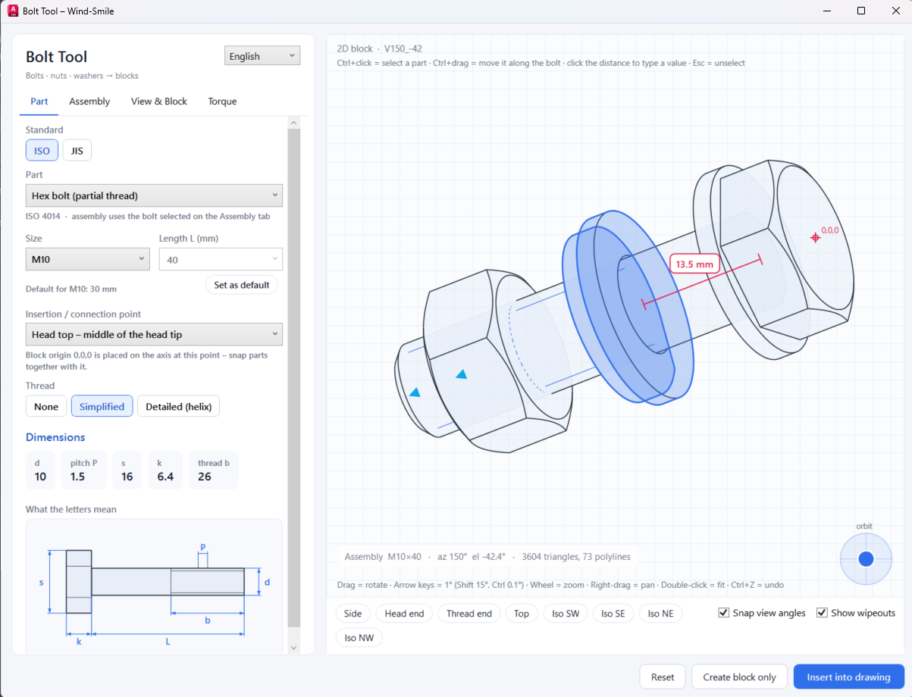

# Bolt Tool – AutoCAD 2027 (.NET 10)



An AutoCAD plugin that generates blocks of bolts, nuts, plain / large / spring washers and complete
bolted connections (ISO or JIS). Blocks can be any 2D view (side, ends, top, isometric, free orbit)
or a 3D mesh / solid, with wipeouts, stretch grips for length, and a tightening-torque calculator.

## Contents

- [Requirements](#requirements)
- [Build, load and update](#build-load-and-update)
- [Commands](#commands)
- [The window](#the-window)
- [Preview controls](#preview-controls)
- [Moving washers and nuts in the preview](#moving-washers-and-nuts-in-the-preview)
- [Keyboard shortcuts](#keyboard-shortcuts)
- [In the drawing](#in-the-drawing)
- [Block rules](#block-rules)
- [Torque calculator](#torque-calculator)
- [Settings and data files](#settings-and-data-files)
- [Known limits](#known-limits)
- [Project layout](#project-layout)

## Requirements

- AutoCAD 2027 (64-bit)
- .NET 10 SDK (x64) to build – https://dotnet.microsoft.com/download/dotnet/10.0
- Windows

## Build, load and update

**First time**

1. Run `build.bat`. If AutoCAD is not in `C:\Program Files\Autodesk\AutoCAD 2027`, pass its folder:
   `build.bat "D:\Autodesk\AutoCAD 2027"`.
2. Either load it once by hand – in AutoCAD type `NETLOAD` and pick
   `bin\Release\net10.0-windows\BoltTool.dll` –
   or make it load at every start: close AutoCAD and run `install.bat`.

`install.bat` copies the DLL and `PackageContents.xml` to
`%APPDATA%\Autodesk\ApplicationPlugins\BoltTool.bundle\`. `uninstall.bat` removes that folder.

**Updating after a code change**

1. Close AutoCAD (it cannot replace a loaded plugin).
2. Run `build.bat`.
3. Run `install.bat`.
4. Start AutoCAD.

> [!IMPORTANT]
> **Older AutoCAD (2025 / 2026, .NET 8):** build with a different target instead of `build.bat`:
> ```
> dotnet build BoltTool.csproj -c Release -p:TargetFramework=net8.0-windows -p:AcadDir="C:\Program Files\Autodesk\AutoCAD 2025"
> ```
> The DLL is then in `bin\Release\net8.0-windows\` – load it with `NETLOAD` (`install.bat` only copies the .NET 10 build).
> Not tested on those versions yet. AutoCAD 2024 and older (.NET Framework 4.8) are not supported.

## Commands

All three are also buttons on the **Bolt Tool** ribbon tab, which is added when the plugin loads.

| Command | Ribbon button | What it does |
|---|---|---|
| `BOLTTOOL` | Bolt Tool | Opens the tool window |
| `BOLTEDIT` | Edit Bolt | Pick a placed Bolt Tool block → its settings load into the window → change them → **Update selected block** |
| `BOLTTORQUE` | Torque | Opens the window on the torque calculator |

## The window

The language (English / 日本語) is switched at the top left; English is the default. Hover any field
for a pop-up explanation. The window reopens in the state it was closed in.

### Part tab – one single part

| Control | Meaning |
|---|---|
| Standard | ISO or JIS dimensions |
| Part | Hex bolt (partial / full thread), socket head cap screw, threaded rod, hex nut, thin nut, plain washer, large washer, spring lock washer |
| Size | M3 … M48. Changing it loads the default length of that size |
| Length L | Length under the head (threaded rod: total length). Pick a standard length or type any value |
| Set as default | Stores the current length as the default for this size |
| Insertion / connection point | Where the block origin 0,0,0 sits on the axis (head top, under head, thread end, middle; for nuts and washers: bearing face, outer face, middle) |
| Thread | None, simplified (thin root lines) or detailed (real helix) |
| Dimensions | The main dimensions of the selected part |
| What the letters mean | Small picture showing where d, P, s, k, L, b, m, d1, d2, h are measured |

### Assembly tab – a bolted connection

| Control | Meaning |
|---|---|
| Create a bolted connection | On: bolt + washers + nut together. Off: only the single part from the Part tab |
| Bolt | Bolt type used in the connection |
| Clamp length | Total thickness of the parts the bolt holds together |
| Washer under head / under nut | None, plain or large washer |
| Spring lock washer – stick to | None, nut side or bolt head side |
| Nut type / Nuts | Hex or thin nut; no nut (tapped hole), one nut, or nut + lock nut |
| Choose standard length automatically | Picks the shortest standard length that fits everything plus the protrusion |
| Thread pitches out of the nut | Required protrusion beyond the nut (2 is the usual rule) |
| Separate block per part | On: each part is its own block, inserted as a linked set. Off: one block for the whole connection |
| Nut side follows the bolt end | When the bolt is stretched with its grip, the nut side moves with the bolt end |
| Reset part positions | Puts washers and nuts back after they were moved in the preview |

### View & Block tab – what goes into the block

| Control | Meaning |
|---|---|
| Output | 2D view, 3D mesh or 3D solid |
| Azimuth / Elevation | Exact view direction. Azimuth 0° = side, +90° = head end, −90° = thread end; elevation 90° = top, 35.26° = isometric |
| Hex spin | Turns the hexagon about the axis: 0° across corners, 30° across flats |
| Show hidden lines | Adds hidden edges with the HIDDEN linetype |
| Scale | Size factor of the block (1 = real size in mm) |
| Add wipeout behind each part | Masks whatever lies under the block |
| Wipeout layer | Layer for the wipeouts (default `01_WIPEOUT`; a new name is created automatically) |
| Length grip snaps to standard lengths | Dragging the length grip jumps between standard lengths |

### Bar under the preview

| Control | Meaning |
|---|---|
| Side, Head end, Thread end, Top, Iso SW / SE / NE / NW | Jump to a standard view |
| Snap view angles | While orbiting, the view catches on standard angles (see below) |
| Show wipeouts | Shows the wipeout areas in the preview only |

### Bottom buttons

| Button | Meaning |
|---|---|
| Insert into drawing | Creates the block(s) and lets you place them (point, then rotation) |
| Update selected block | Shown after `BOLTEDIT`: applies the settings to the picked block |
| Create block only | Creates the block definition without placing it |
| Reset | All settings back to defaults |

## Preview controls

The preview shows exactly what the block will contain. The red cross is the block origin 0,0,0, the
blue triangles are the stretch grips.

| Action | Result |
|---|---|
| Left-drag | Orbit the view |
| Round **orbit** joystick (bottom right) | Hold and push: rotates continuously, faster further from the centre |
| Mouse wheel | Zoom |
| Right-drag or middle-drag | Pan |
| Double-click | Fit |

The zoom stays the same from every direction while orbiting.

**View snapping** (when *Snap view angles* is ticked): turning left / right catches every 30° and 45°;
tilting up / down catches at 0°, 30°, 35.26° (isometric), 45°, 60° and 90°. Arrow keys never snap.

## Moving washers and nuts in the preview

Works in Assembly mode. Useful for setting the gap between the bolt head and the clamped parts by eye
or by number.

| Action | Result |
|---|---|
| Ctrl+click a washer or nut | Selects it (highlighted blue). Ctrl+click more parts to add them |
| Ctrl+click a selected part | Removes it from the selection |
| Ctrl+click empty space, or Esc | Clears the selection |
| Ctrl+drag a part | Moves all selected parts along the bolt in 0.5 mm steps |
| Red distance label | Distance from the underside of the bolt head to the nearest selected part |
| Click the red label | Type an exact distance, Enter = apply, Esc = cancel |

Parts stop when they touch a part that is not selected, or the bolt head. To slide a touching stack,
select all of its parts. With automatic length the bolt grows or shrinks to follow. Moving does not work
when looking straight along the bolt (end views).

## Keyboard shortcuts

| Key | Result |
|---|---|
| Arrow keys | Rotate the view by 1° |
| Shift + arrow | Rotate by 15° |
| Ctrl + arrow | Rotate by 0.1° |
| Ctrl+Z | Undo the last settings change |
| Ctrl+Y or Ctrl+Shift+Z | Redo |
| Esc | Clear the part selection / close the distance field |
| Enter in a number field | Apply the value |

Arrow keys rotate when the focus is not in a text box, list or slider – click the preview first.

## In the drawing

AutoCAD's .NET API cannot create dynamic-block parameters, so the tool adds its own stretch grips to
every block it created (the settings are stored on the block reference as XData):

- **▶ grip at the thread end** – drag to change the bolt length (snaps to standard lengths if the option is on).
- **▶ grip on the nut** (or the nut side of a one-block assembly) – drag to change the clamp length:
  washers, spring washer and nuts move together and, with automatic length, the bolt follows.
- **`BOLTEDIT`** – reopens any placed block in the window for full editing.

For a linked set (separate blocks), editing or stretching one part updates the others.

## Block rules

- Block origin **0,0,0 = connection point on the axis** (default: middle of the bolt head tip; nuts and
  washers: bearing face), so parts snap together.
- All lines are on layer **0** with colour / linetype / lineweight **ByBlock**. Only wipeouts go on the wipeout layer.
- Inside a block the wipeout is drawn first, then the lines. For separate parts the bolt is inserted
  first, then washers and nuts, so their wipeouts cover the shank.
- 2D output is cleaned before it is written: overlapping and duplicate lines are merged (like `OVERKILL`).
- Hide wipeout frames with `WIPEOUTFRAME 0`; `WIPEOUTFRAME 2` shows them on screen but does not plot them.
- Block names look like `BT_ISO_HB_M12x40_SIDE_A1B2C3D4`; identical settings reuse the same definition.

## Torque calculator

Choose size, property class, bolt / nut surface, lubrication and the clamped material. The friction
values fill in from the lists and can be overtyped. Results: preload F_M, tightening torque M_A with a
range for μ ± 0.02, a surface-pressure check under the head, and a table for all sizes.

Method: simplified VDI 2230-1 –
`M_A = F_M · (0.16·P + 0.58·d2·μG + μK·D_Km/2)`, preload at the chosen yield utilisation (default 90 %).

> [!WARNING]
> The friction coefficients are typical values, not supplier data. Use the results as guidance and
> confirm with the fastener supplier for critical joints.

## Settings and data files

Everything is stored in `%APPDATA%\BoltTool\`:

| File | Content |
|---|---|
| `standard_ISO.json`, `standard_JIS.json` | Dimension tables and default lengths – editable |
| `settings.json` | Last used part, assembly, view and block settings |
| `ui.json` | Window size and position, last tab, torque selections |
| `language.txt` | `en` or `ja` |

> [!WARNING]
> The dimension tables (especially JIS head / nut sizes and spring washers) are typical catalogue values
> that have not been checked against the standards. Compare them with your supplier's catalogue and
> correct the JSON files where needed. Restart AutoCAD after editing.

Deleting a file resets that part to its defaults.

## Known limits

- A 3D solid with detailed helical thread usually cannot be converted to a real solid and stays a mesh.
  Use simplified or no thread for solids.
- Wipeouts cannot have holes: in end views a nut's or washer's wipeout also covers its hole.
- Parts moved in the preview can be dragged past the thread end; with a manual bolt length this gives a
  "shorter than required" warning.
- The Japanese texts are unreviewed.
- Blocks already in a drawing keep their old geometry after a plugin update; re-insert or `BOLTEDIT` them.

## Project layout

| Folder / file | Role |
|---|---|
| `Data/` | Size tables, block parameters (`BoltJob`), saved settings |
| `Geometry/` | Part meshes, assembly layout, hidden-line renderer |
| `Cad/` | Block creation, insert jig, linked-set updates, stretch grips |
| `UI/` | Window, preview, legend, ribbon tab, English / Japanese texts |
| `Torque/` | Torque calculation |
| `Commands.cs` | AutoCAD commands and plugin start-up |
| `build.bat`, `install.bat`, `uninstall.bat` | Build and autoload |
| `HANDOFF.md` | Developer notes for continuing the work |
